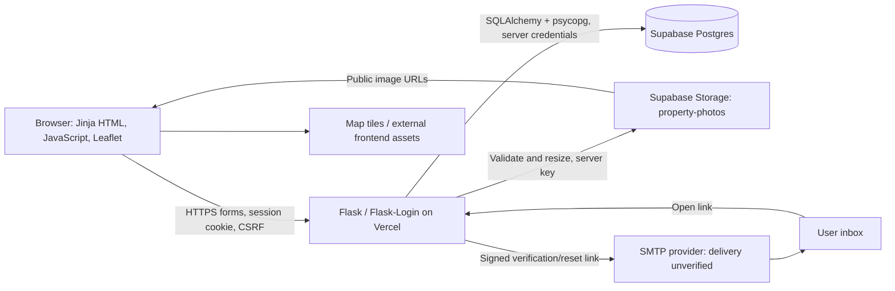

# Rent Me architecture and production operating plan

14 October 2026. Read with the [technical audit](TECHNICAL_AUDIT.md), which records verification status. This is a recommended plan; proposed services and procedures are not represented as installed or tested.

5 November update: Vercel team access and deployment listing now work; the latest production deployment is READY at commit `2f8cfbd`. References below to blocked access describe the original audit. Configuration, runtime health and hosted acceptance checks still require inspection.

## Current components and flow

The diagram describes the configured hosted path supported by code, not a verified deployed connection chain. Detailed Vercel access is blocked. Locally, SQLite and a photo folder replace Supabase; email can go to the development mailbox. On Vercel, missing configuration falls back to `/tmp`, and missing stable signing configuration can produce an ephemeral key. Those fallbacks must be disabled for production.

| Component | Responsibility / trust boundary |
|---|---|
| `routes.py`, `listings.py`, `accounts.py`, `admin.py` | Server-rendered app, search/map API, ownership checks, moderation, login and email flows. Browser input is untrusted. |
| `models.py` | Users, listings, photos, amenities, favorites, messages, reports and rate-limit hits. Photos store object names; files are not database blobs. |
| `app.py`, Flask-Migrate/Alembic | App factory, CSRF and schema preparation. Migrations currently run at startup with advisory locking on Postgres. |
| `config.py`, `pyproject.toml`, `vercel_app.py` | Environment selection and Vercel entrypoint; optional AI dependencies are separated. |
| `security.py`, Flask-Login, itsdangerous | Password rules, signed token expiry, session fingerprint invalidation, rate limits and administrator checks. No Supabase Auth login integration exists. |
| `photos.py` | Decode/re-encode/resize images and call Storage with a server-only key. Browser reads currently use public URLs. |
| `mailer.py` | Synchronous SMTP handoff or local test mailbox. A successful SMTP send is not proof of inbox receipt. |

Data relationships: one user owns many properties; properties have ordered photos and amenities; favorites join users/properties with a uniqueness constraint; messages link sender/recipient and optionally a property; reports link reporter/property and moderation outcome. Admin verification/hiding records reference the acting user. Rate-limit rows are operational data and need bounded retention.

An upload passes ownership and verification checks, then image validation and storage upload, then the database commit. Failed commits attempt to remove new objects; successful updates delete removed objects afterward. Database and object store changes are not one atomic transaction. Failed cleanup needs reconciliation and a durable retry path.

## Recommended production setup

Keep the Flask monolith for the first release. Retain Postgres and object storage; avoid a broad rewrite or migration to Supabase Auth during launch hardening. Keep optional LLM search off. Split development, staging and production database/storage/secrets. Never allow unreviewed previews to use production credentials.

1. Use a stateless web runtime, stable secret key, canonical HTTPS origin and verified proxy configuration. Match function region to the database after measuring Botswana user latency. Require persistent DB/storage settings at startup; remove automatic demo seeding from production.
2. Use a Postgres pooler appropriate to the runtime. Confirm TLS and bounded connect/query timeouts. Separate a controlled schema-migration identity from the runtime identity. Because the current app has no per-user DB claims, replacing its owner connection with an ordinary role without an access policy would break the app; design/test least privilege deliberately. Browser roles must not access private app tables.
3. Run migrations once per reviewed release, with backup and compatibility checks. Set runtime `AUTO_MIGRATE=0`. Prefer additive changes compatible with old/new app instances, followed by cleanup later. An application rollback does not roll back a schema or restore deleted data.
4. Resolve upload size before selecting the final hosting envelope. Near-term: enforce a total multipart request below the host ceiling with a matching UI and boundary tests. If 10 large photos must be accepted, design authorized direct uploads into a private staging area, validate/re-encode on a trusted worker, then publish sanitized objects and commit references. Never expose the service key or trust a browser MIME claim. This larger workflow is follow-up work, not an implemented feature.
5. Choose whether photos of drafts/hidden listings require privacy. Recommended: private staging/draft objects; publish only approved public derivatives, with explicit deletion/cache behavior. Keep identity documents out of the public bucket. Add MIME/size limits as defense in depth.
6. Configure an approved SMTP sender with TLS verification, SPF/DKIM and a reviewed DMARC policy. Use canonical HTTPS links. Test delivery before enabling public registration. Add retries/queueing if measured latency or failures require it; avoid detached work that can be killed with a function instance.
7. Lock and scan dependencies in CI, run Postgres integration tests and release smoke checks, then promote a tested build. Retain the previous known-good build and record its schema compatibility.

October: use current free development resources, local Postgres or an existing isolated free staging database, local SMTP capture and free CI/monitoring within quotas. Do not buy infrastructure. November: approve hosting eligibility/capacity, managed backups/PITR if recovery needs justify it, independent backup storage, mail delivery and alert retention. Verify current plan terms and limits then; no prices or paid tier are assumed here.

## Production configuration evidence to collect

Record presence, target scope and validation result, never secret values:

| Setting | Required evidence |
|---|---|
| `APP_ENV`, debug | Production mode, debug disabled, dev mailbox inaccessible. |
| `SECRET_KEY` | Stable across instances/deployments, private, rotation/recovery procedure; cookies and links behave as expected after redeploy. |
| `DATABASE_URL` | Intended project/database, TLS, pooler compatibility; no SQLite or `/tmp` in production. |
| `SUPABASE_URL`, server key, bucket | Intended isolated project/bucket, server-only scope, upload/read checks, bucket limits. |
| `PUBLIC_BASE_URL`, cookie flags, proxy count | Canonical HTTPS links, Secure/HttpOnly/SameSite cookies, trusted host/proxy tests. |
| SMTP settings | TLS validation, approved sender, real delivery and safe failure handling. |
| `AUTO_MIGRATE`, seed behavior | Migrations in release job; production runtime neither migrates nor seeds automatically. |
| Vercel project | Repo/branch/SHA, domains, runtime version/region, protection, resource limits, logs and alert destinations. |

## Hosted persistence and mail acceptance procedures

Run on isolated staging, not by restarting the live project. Prerequisites: authorized deployment access, staging credentials, dedicated test account/inbox and configured SMTP. Never paste credentials into tickets.

**Durability:** create a uniquely tagged test listing and sanitized test photo through the app. Record listing ID, object name, byte SHA-256, schema version and deployment SHA. Verify gallery loads. Start a fresh app instance against the same services, then redeploy the same reviewed build to staging. In a fresh browser session verify login, listing fields, message/favorite references where applicable, image bytes and gallery order. Check old sessions according to the intended policy. Prove settings target persistent services, not `/tmp`. Record before/after checks, timestamps and deployment IDs. Leave cleanup of test data to the agreed staging process; never delete real listings as part of a drill. **Not executed in this audit.**

**Email:** register a test user; confirm publish/new-message gates before verification. Check arrival, spam folder and sender; open the HTTPS link and verify the gates change. Resend with rate-limit tests. Request reset using the generic response, receive it, choose a new password, verify old password and old sessions fail and new login works. Reuse the link and confirm rejection. Test invalid/expired links and stale verification links after email change; use controlled test-time configuration for expiry rather than weakening production settings. Verify error behavior when SMTP is unavailable. Record result/timestamps with redacted message identifiers, never token URLs. **Real delivery not executed.**

## Backup and restore runbook

### Ownership and recovery targets

Proposed owner: Rodney or a named operations delegate. Proposed initial targets requiring owner sign-off: maximum **24 hours of lost data (RPO)** and **4 hours to restore service (RTO)**. These are goals, not measured guarantees. If one day of lost listings/messages is unacceptable, choose more frequent coordinated exports and/or database PITR plus matching object retention before launch.

Database backups do not include photo bytes; retain both. Proposed retention: 7 daily pairs, 4 weekly pairs and 3 monthly pairs, with a pre-migration pair retained through the rollback window (at least 7 days). Store encrypted copies away from the primary Supabase project/account, with a second independent copy where feasible. Restrict access, test encryption recovery and never commit backups or keys. Apply retention to deleted personal data too; keep a deletion ledger to reapply deletions if an older backup is restored.

### Capture procedure

1. Allocate a unique UTC backup ID and record code SHA/schema revision. Pause staging writes or use a coordinated snapshot process. A database snapshot and an object listing taken during ongoing deletions can disagree; do not call an uncoordinated pair consistent.
2. For local SQLite, use SQLite's backup API rather than copying an open database file. For Postgres, use a compatible `pg_dump`/Supabase export workflow against an authorized connection, including application schema/data, migration revision, sequences, grants and RLS definitions. Record required roles/extensions separately without role passwords. Verify exact tooling and restore permissions in the target environment. Do not overwrite Supabase-managed schemas blindly.
3. Export every required photo object's actual bytes through the Storage API or a supported storage client; export bucket visibility, MIME/size configuration and relevant policies separately. A `storage.objects` row is only metadata, not a photo backup.
4. Produce a manifest containing object key, size and SHA-256, plus table row counts, schema revision, dump checksum, export time and tool version. Compare property-photo references with exported keys, including legacy cover filenames. Missing required objects fail the backup. Review unreferenced files; do not delete them automatically.
5. Encrypt and copy the database, object files and manifest to the independent destination. Verify checksums after transfer. Keep encryption recovery material separately with authorized access. Alert on failure or if the newest successful pair is older than 26 hours.
6. Resume writes and record success only after both sides are verified. During October perform this locally/free; the production scheduler and backup destination are not yet implemented.

### Restore procedure and testing

1. Choose a matching backup pair and provision an empty **isolated** target. Never test by overwriting production. Disable outbound mail, background tasks and demo seeding. Block public access.
2. Verify checksums and decrypt. Restore app schema/data, required roles/grants/RLS, sequence positions and migration revision using compatible tools. Review any destructive restore options before executing. Restore bucket configuration and upload object bytes through the Storage API, preserving keys; do not insert metadata alone and assume files exist.
3. Point the corresponding reviewed app build at the restored target. Keep auto-migration off initially; prove the restored revision before applying a separately tested upgrade. Secrets come from the secure configuration store, not the database dump. Decide whether to rotate signing keys to invalidate old sessions/recovery links after an incident.
4. Check table counts, foreign-key integrity, sequences, gallery order/cover, all referenced object hashes, public/private visibility, login, search/map, favorites, messages and moderation using test accounts. Reapply any post-backup deletion ledger. Ensure no real email is sent.
5. Measure elapsed recovery time and backup age; compare with RTO/RPO. Store a redacted drill report with backup ID, code SHA, checks, timing and discrepancies. A successful download is not a successful restore.
6. Run a hosted drill before launch, monthly afterward and after major schema/storage changes. For actual disaster recovery, approve cutover, freeze writes, restore into a replacement target, smoke-test, switch configuration/DNS and monitor; retain the previous target until recovery is accepted. Communicate the actual data-loss window.

Audit verification: `tests/test_persistence.py` demonstrates a small paired **local SQLite/photo** restore and app recreation. No production backup was created or restored, no hosted restore timing was measured, and retention/scheduling remain follow-up work. Supabase's [backup documentation](https://supabase.com/docs/guides/platform/backups) explains why object exports are separate.

## Monitoring and alert plan

Existing: Flask warning/error logs for email/storage, provider status and Supabase advisors. Missing in code: dedicated health/readiness checks, structured correlation IDs, error reporting integration and alert tests. External monitor/log-drain setup is unknown because Vercel access was blocked.

| Signal | Proposed implementation / threshold | Action |
|---|---|---|
| Availability | Free external HTTPS probe every 5 minutes; alert after 2 consecutive failures, notify recovery once | Check deployment and dependency status; roll back only if schema-compatible. |
| Readiness | Cheap bounded DB query in a protected/minimal readiness check; separate basic liveness; expose no config | Investigate pool exhaustion, timeouts or migration mismatch. Avoid uploading objects on every probe. |
| Application errors | Structured logs/error tracker, release SHA and request ID; alert for >1% 5xx over 5 minutes with at least 100 requests, or repeated failures at low traffic | Inspect sanitized traces; correlate deployment, DB, storage and SMTP. |
| Critical operations | Count failed photo writes/deletes and mail failures; alert on 3 consecutive failures | Check provider/config; retry safely; reconcile orphan files without blindly deleting. |
| Latency/resources | Staging load baseline; initial alert p95 >2s for 10 minutes; monitor connections, CPU, storage/egress and quotas | Tune measured queries/region/pool; scale only with approved budget. |
| Backup freshness | Latest verified pair >26h old or any checksum/export failure | Investigate immediately; rerun capture and verify restore viability. |
| Security/abuse | Rate-limit bursts, admin actions, unusual failures, storage growth | Review abuse patterns without logging passwords, message content or tokens. |

Assign an alert recipient and backup responder before launch. Proposed log retention: 14 days sanitized operational logs, 90 days minimal administrator audit events, reviewed against privacy needs and available free quotas. Redact cookies, authorization headers, SMTP credentials, query strings and token-bearing paths; disable body capture for account/message routes. Do not sample away critical backup/authorization failures. Rehearse a synthetic outage and mail/storage failure in staging, verify receipt and recovery, and document escalation. If free tools cannot meet the needed retention or delivery guarantees, make that an explicit November infrastructure decision.

## Launch sign-off

Launch only when audit P0 checks have evidence, a named operator can restore both data and photos, real users can receive account mail, upload limits match the hosting path, and a tested rollback/alert process exists. Record unresolved P1 risks and owner acceptance. This plan does not authorize purchases or production changes.
